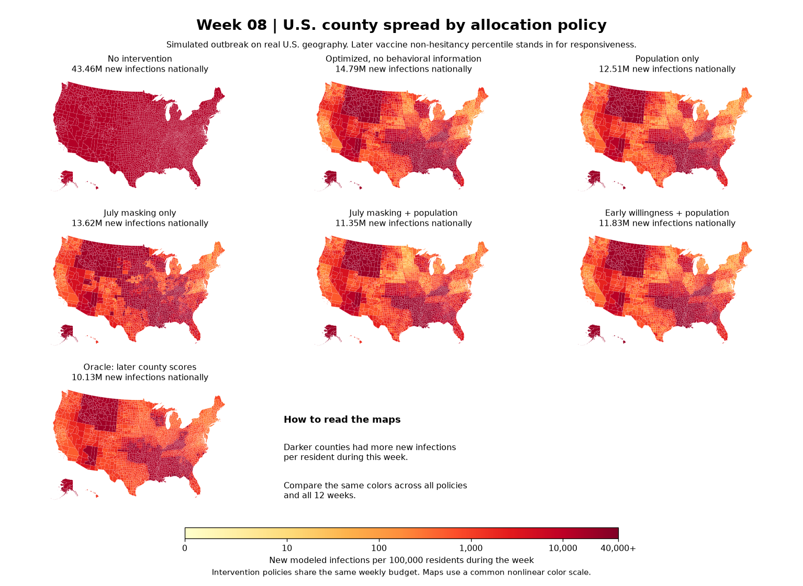

# Technical reference: U.S. weekly allocation

**Result.** In an 84-day simulation on the U.S. county network, adding early vaccine willingness to a population-based predictor reduced modeled infections from **93.03 million to 90.38 million** with the same weekly budget. That is **2.85% fewer than population only** and **7.82% fewer than an optimized plan without county behavioral information**. A separate synthetic experiment establishes what the same model can do when it is told the actual responsiveness of every county.

[Week-by-week maps](#week-by-week-county-spread) · [What an oracle knows](#what-an-oracle-knows) · [Data](#datasets) · [Math and parameters](#model-and-parameters) · [Results](#results) · [Reproduce](REPRODUCE.md)

## Week-by-week county spread

[Week 1](spread/week_01.png) · [2](spread/week_02.png) · [3](spread/week_03.png) · [4](spread/week_04.png) · [5](spread/week_05.png) · [6](spread/week_06.png) · [7](spread/week_07.png) · [8](spread/week_08.png) · [9](spread/week_09.png) · [10](spread/week_10.png) · [11](spread/week_11.png) · [12](spread/week_12.png)

Each weekly image shows all **seven main policies**, using new infections that week per 100,000 county residents. The national number above each map is the sum of new infections during that week. The fixed nonlinear scale makes early spread visible and lets you compare the same color across weeks and policies; values above 40,000 are shown in the darkest color. The [national curves](weekly_proxy_comparison.png) show **cumulative** infections. The [county difference maps](weekly_proxy_county_maps.png) compare early willingness with the uninformed policy at weeks 4, 8 and 12: blue means fewer cumulative infections, red means more. A national improvement can come with local losses because every intervention plan has the same budget.

## What an oracle knows

**Responsiveness** ($p_i$) tells the model how strongly a fixed dose reduces transmission in county $i$. It is not a statistical p-value. We do not have a dataset that directly measures county responsiveness to a common intervention dose.

An **oracle** is an idealized planner that sees the exact county values the simulator will use. It has the same budget, disease model and weekly scheduling constraints as the other planners. It illustrates how much better the allocation can get with better information under the model. We compute its schedule numerically, so the result is a reference point rather than a certified global optimum.

| Experiment | What plays the role of true $p_i$? | What does the oracle know? |
|---|---|---|
| Pure information benchmark | Independent synthetic values drawn uniformly from 0 to 1 for each county | The actual simulated draw for each county |
| U.S. survey proxy experiment | The percentile of a county's later HHS vaccine non-hesitancy estimate | The exact later HHS percentile for each county |

The first experiment asks whether knowing $p_i$ can help at all. The second asks whether earlier behavior surveys supply useful information about **a measurable surrogate** for $p_i$. The two experiments share the county network and main model settings, but their responsiveness maps are different. The survey oracle does not observe an actual causal treatment effect or predict historical infections.

## Datasets

| Input | What was used | Role |
|---|---|---|
| [U.S. Census](https://www.census.gov/programs-surveys/popest/data/data-sets.html) | 2019 population estimates for 3,142 counties and county equivalents; 328,239,523 residents in total | County sizes, budget weights, and the population-only predictor |
| [GeoDS weekly mobility](https://github.com/GeoDS/COVID19USFlows-WeeklyFlows) | Twelve observed weekly county flow matrices starting Sept. 7 through Nov. 23, 2020 | Geographic mixing structure; self-edges are removed and incoming flows normalized by destination |
| [NYT/Dynata masking](https://github.com/nytimes/covid-19-data/tree/master/mask-use) | July 2–14, 2020; 3,142 county estimates | Mask score: ALWAYS + FREQUENTLY + half of SOMETIMES |
| [Delphi CTIS masking](https://cmu-delphi.github.io/delphi-epidata/api/covidcast-signals/fb-survey.html) | October 2020 county averages of `smoothed_wwearing_mask`; at least seven observed days, 515 counties | Adds a second masking measurement in a follow-up |
| [Delphi CTIS vaccine willingness](https://cmu-delphi.github.io/delphi-epidata/api/covidcast-signals/fb-survey.html) | February 2021 county averages of `smoothed_waccept_covid_vaccine`; at least seven observed days with data issued before May 26; 475 counties covering 74.4% of the population | Earlier measure of willingness used by the best-performing allocation |
| [HHS/ASPE vaccine hesitancy](https://aspe.hhs.gov/reports/vaccine-hesitancy-covid-19-state-county-local-estimates) | May 26–June 7, 2021; modeled small-area estimates from the Household Pulse Survey | Later target: one minus the estimated hesitant fraction; county percentile in the main experiment |

County records are joined by Census FIPS code. CTIS monthly values are averages of overlapping daily estimates, not independent county-month survey samples. Missing CTIS scores remain missing for the predictor to handle. HHS estimates are modeled values, not direct observations of every county. The [NYT COVID case series and TBCOV sentiment](../../DATA_SOURCES.md) appear elsewhere in the project; neither supplies epidemic states or predictor features in this experiment. The dates of the mobility data and surveys differ because the mobility network is used as a fixed geographic setting for a simulation.

## Model and parameters

Let $S_i(t)$, $I_i(t)$, $R_i(t)$ be the susceptible, infectious and removed counts. Let $w=\lfloor t/7\rfloor$ be the week index and $W^{(w)}_{ij}$ the normalized flow weight from origin $j$ to destination $i$. The daily infection hazard is

$$
\lambda_i(t)=\beta\,e^{-p_i d_{wi}}
\left[(1-m)\frac{I_i(t)}{N_i}+m\sum_j W^{(w)}_{ij}\frac{I_j(t)}{N_j}\right].
$$

Here $d_{wi}$ is the dose assigned to county $i$ in week $w$. The exponential factor is the proposal's intervention mechanism: $p_i=0$ means no effect, and higher $p_i d_{wi}$ gives stronger attenuation with diminishing returns. For example, $p_i=0.5$ at dose $0.8$ multiplies the original hazard by $e^{-0.4}\approx0.67$. This is a hazard multiplier, not a direct percentage reduction in cumulative infections.

Daily new infections and recoveries are

$$
X_i(t)=S_i(t)(1-e^{-\lambda_i(t)}),\qquad Y_i(t)=\rho I_i(t),\qquad \rho=1-e^{-1/7}.
$$

Each day, $X_i$ moves from $S_i$ to $I_i$ and $Y_i$ moves from $I_i$ to $R_i$. The simulation uses expected counts, so counts can be fractional before aggregation and $S_i+I_i+R_i=N_i$ is conserved.

| Parameter | Main setting | Meaning |
|---|---:|---|
| Horizon | 84 days | Twelve weekly allocations and daily SIR updates |
| $\beta$ | 0.36 per day | Fixed transmission scale in this experiment; not fitted to historical case counts |
| $m$ | 0.15 | Weight on the incoming mobility component of the hazard |
| Recovery probability $\rho$ | About 0.133 per day | Discrete probability from a continuous recovery hazard of $1/7$ per day |
| Initial prevalence | 0.0001 in every county | Ten infectious people per 100,000 in expectation; no prior immunity |
| Average dose per week | 0.8 | Population-weighted national dose; a normalized effort unit, not dollars |
| County dose cap | 8 | Same cap for all intervention policies |
| Synthetic $p_i$ | Uniform on $[0,1]$ | Independent across counties; one fixed value per county during each simulation |
| Survey $p_i$ | HHS percentile or raw fraction | Fixed per county; the raw scale is a sensitivity analysis |

### How the allocator works

It chooses a dose for every county and week to minimize total new infections $C=\sum_i[S_i(0)-S_i(84)]$, subject to the weekly constraint

$$
0\le d_{wi}\le 8,\qquad \sum_i N_i d_{wi}=0.8\sum_i N_i.
$$

The weekly budget is an equality, so the informed plan cannot spend more. The optimizer uses $d_{wi}=8\,\sigma(z_{wi}+b_w)$, where $\sigma$ is the logistic function. A bisection search chooses one shift $b_w$ per week to meet the budget. A backward pass through the daily SIR updates computes how changing each dose affects infections through the end of the horizon, including infections that reach other counties. L-BFGS-B uses these derivatives to refine the plan. Informed schedules use an independent-county allocation as a starting point, refine a static schedule for up to 80 iterations, then refine the weekly schedule for up to 80 iterations. This is finite local optimization and a preplanned schedule, not an adaptive feedback policy or PPO.

A second contact mechanism was tested during development. If $g_i=e^{-p_i d_{wi}/2}$ and $v_i=I_i/N_i$, it uses $\beta g_i[(1-m)g_i v_i+m\sum_jW_{ij}g_jv_j]$. This applies attenuation at both ends of mobility contacts while keeping local attenuation at $e^{-p_i d_{wi}}$. It gave smaller gains from information in the development comparison, so the final experiments use the original mechanism.

### How information changes the schedule

- **No intervention:** all doses are zero; this establishes the overall intervention effect.
- **Optimized without county behavioral information:** the planner knows county sizes, mobility, initial states and the aggregate prior. It minimizes average modeled infections over eight synthetic prior maps and the comparator is selected using eight separate prior-validation maps. The resulting schedule is frozen before confirmation. It can prioritize counties without seeing their actual $p_i$.
- **Population only:** the same class of regression model predicts the HHS target using log county population. This tests how much of the gain can come from knowing population alone.
- **July masking only:** use the county mask percentile directly on the main scale. This asks whether survey rank is enough on its own.
- **July masking plus population / early willingness plus population:** histogram gradient boosting predicts the target from the listed features. Five folds hold out groups of entire states; every county's prediction comes from a model trained on other states. Both use 80 boosting iterations, up to eight leaves, at least 40 samples per leaf and L2 regularization of 1. The national schedule is then planned from the combined out-of-fold predictions.
- **Oracle:** same epidemic model and budget, but plans with the actual values used by the simulator. All schedules in a comparison are executed on the **same** responsiveness map, not on each planner's predictions.

On the main survey scale, a score is converted to $(\mathrm{midrank}-0.5)/n$ across counties. This preserves order but spreads the target across nearly the full 0–1 interval. The raw check substitutes the HHS fraction directly and gives the uninformed planner its aggregate histogram without county labels. That changes both the mean and spread of responsiveness. It is not a test of variation alone.

### Reproduction details and assumptions

| Item | Exact setting |
|---|---|
| Development response draws | Seeds 1010000–1010002 |
| Prior training and validation | Seeds 1015000 and 1016000, respectively; eight values per county, one random value from each eighth of the unit interval, in randomized order |
| Confirmation draws | Seeds 1011000–1011015; independent of the prior and development draws |
| Raw target prior | Eight quantiles of the observed national county-score distribution, assigned with county-specific random permutations (seed 1049000); no HHS county labels are given to that planner |
| Initialization grid | County dose grid 0 to 8 in steps of 0.1; effective-dose grid 0 to 8 in steps of 0.025 |
| Optimizer | L-BFGS-B, 80 iterations per static or weekly refinement, up to 20 line-search steps, history size 8, objective scaled by one million, tolerances 1e-10 (relative objective) and 1e-7 (projected gradient) |
| Stress checks | Change mean dose to 0.6 or 1.0, mobility to 0.05 or 0.30, or transmission to 0.30 or 0.42; no replanning in the reported frozen-schedule stress table |
| Synthetic uncertainty | Paired bootstrap over the 16 response maps, 10,000 draws (seed 1019000); intervals are conditional on this model and its fixed parameters |

County populations and the response score are fixed over the horizon. Mobility affects infection exposure, not the number of residents in a county. Dose takes effect in its assigned week, with no explicit carryover other than the changing epidemic state. The objective counts infections equally across individuals and does not price spending in dollars, model age, or impose county equity constraints. Weekly mobility and the epidemic settings are available to every planner. The survey target and model are fixed before evaluating a schedule; predictor accuracy comes from held-out states, while the allocation comparison still uses one nationwide target map.

## Results

For any policy with modeled infections $C_\pi$, the reduction versus the uninformed schedule is $(C_U-C_\pi)/C_U$. The share of the oracle gap recovered is $(C_U-C_\pi)/(C_U-C_O)$. The first tells us the size of the infection reduction; the second puts that reduction in the context of how much room there was to improve.

### Synthetic perfect-information benchmark

| Allocation | Mean modeled new infections | Reduction versus no intervention |
|---|---:|---:|
| No intervention | 299.53M | — |
| Uniform per-resident dose | 191.15M | 36.18% |
| Optimized, no county $p_i$ | 188.34M | 37.12% |
| Oracle knows the synthetic $p_i$ values | 155.25M | 48.17% |

The oracle prevented **33.09 million** additional modeled infections, or **17.57% fewer** than the uninformed plan across 16 independent confirmation maps. Every map improved; the paired-world bootstrap interval is **16.93–18.14%** and measures variation across the synthetic maps only. Dose and mobility stress tests with frozen plans retained roughly 12–22% gains, while a lower-than-planned transmission rate reversed the gain under the frozen schedule. That is why epidemic calibration and replanning matter. See the [benchmark plot](perfect_information_validation.png), [individual trials](perfect_trials.csv), and [stress results](perfect_stress_summary.csv).

### U.S. survey surrogate experiment

| Allocation | Modeled new infections | Reduction versus uninformed |
|---|---:|---:|
| No intervention | 299.53M | — |
| Optimized, no county behavioral information | 98.05M | — |
| Population only | 93.03M | 5.12% |
| July masking alone | 98.53M | −0.50% |
| July masking plus population | 91.54M | 6.64% |
| February vaccine willingness plus population | **90.38M** | **7.82%** |
| Oracle knows the later HHS percentile | 71.80M | 26.77% |

Early willingness plus population recovered **29.22%** of the oracle gap; July masking plus population recovered **24.79%**. Adding both masking surveys to the willingness predictor yielded **90.82M** (7.37% fewer versus uninformed), so the extra inputs did not improve that allocation. July and October masking plus population yielded **90.89M** (7.30% fewer). Rank-stretching the learned predictions did worse than the uninformed policy in all three calibration follow-ups. Applying the original survey plans to unrelated synthetic $p_i$ maps also did not help. This supports the idea that usable alignment with responsiveness matters more than adding variation to a score.

On the **raw HHS scale**, the uninformed plan already reduced infections by **98.57%** versus no intervention at this normalized dose. Masking plus population reduced the remainder by **2.82%** (about 121,000 modeled infections), and the oracle by **5.50%**. The raw comparison covers the original masking policies and controls; the later willingness follow-up was run on the percentile scale only.

### Is the proxy with the highest variation best?

NYT masking had the widest spread across all available counties (11.13 percentage points standard deviation), but the indicators cover different county sets. Among the 462 counties with all indicators, early CTIS vaccine willingness had a wider spread than NYT masking (8.38 versus 6.94 points), while both had similar Spearman rank correlation with later HHS estimates (0.66 and 0.67). The allocation experiment matters because a proxy can be variable, or even rank counties reasonably well, and still recommend the wrong dose in counties that drive national spread.

### What the project establishes

This is evidence that useful county information can improve fixed-budget allocation in the model, and that an earlier survey added some value beyond population under one U.S. survey surrogate. It is not evidence that the same percentages would hold for historical COVID spread. The proxy experiment uses one national target map, a fixed transmission setting, and no directly observed spending-to-response labels. The synthetic confidence interval does not quantify uncertainty in the proxy results. A useful next step is to evaluate the same allocation method against county changes observed after a specific intervention with a known timing and dose.

For exact commands and expected outputs, see [REPRODUCE.md](REPRODUCE.md).
