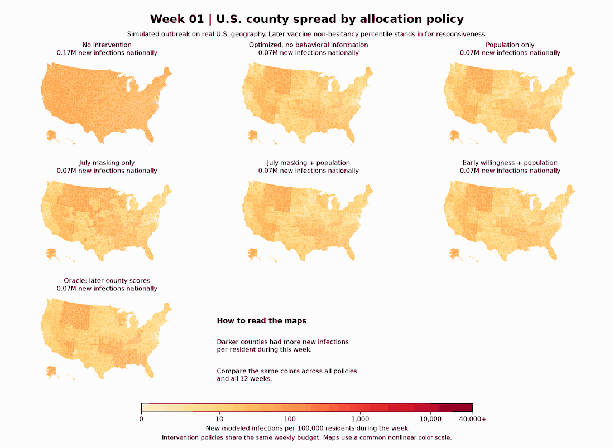

# Can county behavior data improve epidemic resource allocation?

**Yes, in this simulation.** With the same weekly budget, the best survey-based plan produced **7.82% fewer modeled infections** than an optimized plan without county behavior data, and **2.85% fewer** than a population-only predictor. This is a result on a real U.S. county network with a simulated outbreak and an assumed measure of responsiveness.

[Exact reproduction steps](REPRODUCE.md) · [Equations, data, and all parameters](METHODS.md) · [Results CSV](proxy_summary.csv)

## Watch the outbreak unfold

[Week 1](spread/week_01.png) · [2](spread/week_02.png) · [3](spread/week_03.png) · [4](spread/week_04.png) · [5](spread/week_05.png) · [6](spread/week_06.png) · [7](spread/week_07.png) · [8](spread/week_08.png) · [9](spread/week_09.png) · [10](spread/week_10.png) · [11](spread/week_11.png) · [12](spread/week_12.png)

Each frame shows **new infections during that week per 100,000 residents**. Darker means more new infections. The seven panels use the same color scale in every frame. See the [national cumulative curves](weekly_proxy_comparison.png) or [county gains and losses](weekly_proxy_county_maps.png) for a different view.

## The experiment, from start to finish

1. **Build the network.** Join 3,142 counties by five-digit FIPS code. Census populations set county sizes. Twelve GeoDS mobility matrices from fall 2020 connect counties. Incoming flows are normalized by destination.
2. **Set up the outbreak.** Start each county with 0.01% infectious and no prior immunity. Run an 84-day deterministic SIR model with daily updates. Use transmission rate 0.36/day, mobility weight 0.15 and daily recovery probability `1 − exp(−1/7)`.
3. **Define responsiveness.** Each county gets a value `p` between 0 and 1, held fixed for the outbreak. It tells us how strongly a dose `d` reduces the infection hazard: multiply the hazard by `exp(−p × d)`. For example, `p = 0.5` and `d = 0.8` multiply the hazard by about 0.67. A responsiveness score is neither a statistical p-value nor a measured response to spending.
4. **Choose what the planner can see.** First, draw independent synthetic responsiveness values and test whether perfect information helps at all. Next, run a separate experiment where later county HHS vaccine non-hesitancy percentiles stand in for responsiveness. Compare schedules based on population only, earlier surveys, and the exact later county scores.
5. **Plan and score every policy.** Optimize all 12 weekly doses in advance. Every intervention schedule has a population-weighted mean dose of 0.8 per week and a county cap of 8. Then run each schedule on the **same** responsiveness map for that comparison. Count all new infections over 84 days. The dose is a normalized effort unit, not a dollar amount.

### What does “oracle” mean?

The oracle is a planner with the answer key: it knows the county responsiveness values the simulator will use. In the synthetic experiment it sees the random draws. In the survey experiment it sees the exact later HHS percentiles. It has the same budget and uses the same numerical optimizer. Its result is a reference for what better information could achieve in this model. It has no access to actual causal responses to interventions.

## What we found

| Survey experiment: information available to the planner | Modeled infections | Fewer than uninformed |
|---|---:|---:|
| No intervention | 299.53M | — |
| Optimized, no county behavior data | 98.05M | — |
| County population only | 93.03M | 5.12% |
| July masking alone | 98.53M | −0.50% |
| July masking + population | 91.54M | 6.64% |
| February vaccine willingness + population | **90.38M** | **7.82%** |
| Oracle with later HHS county scores | 71.80M | 26.77% |

- **Does information matter at all?** In 16 held-out synthetic scenarios, the optimized uninformed plan averaged 188.34M infections and the oracle averaged 155.25M: **17.57% fewer**. This is a separate comparison with different responsiveness maps; don’t compare those totals directly with the survey table.
- **Does behavior add value beyond population?** Early willingness plus population reduced infections by **2.65M** compared with population only and recovered **29.22%** of the survey oracle’s advantage. Masking alone was slightly worse than the uninformed plan.
- **Does the scale matter?** Yes. With raw HHS fractions in place of percentiles, the masking-plus-population gain was **2.82%** versus uninformed. The early-willingness follow-up was evaluated on the percentile scale only.

The county network and surveys are real. The initial outbreak and infection outcomes are simulated; the HHS percentile is an assumed surrogate. We did not fit this simulation to historical case counts or estimate the causal effect of spending. The schedules are planned in advance, so the comparison does not test how a planner would adapt to new case reports.

**To hand this project to another researcher or AI:** start with [REPRODUCE.md](REPRODUCE.md) for commands, inputs, and expected checkpoints, then read [METHODS.md](METHODS.md) for the exact math, data transformations, optimizer, and limitations.
