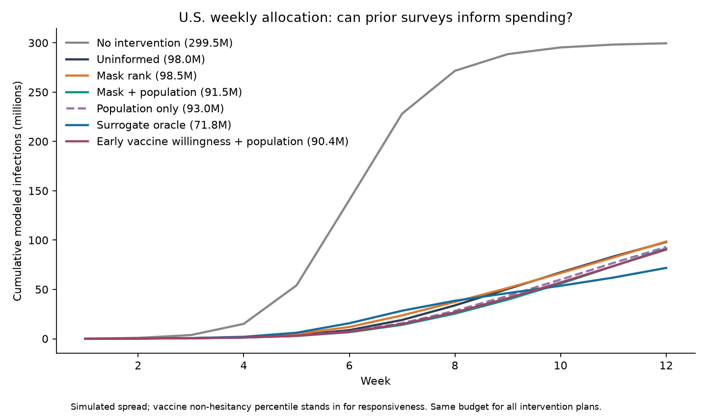
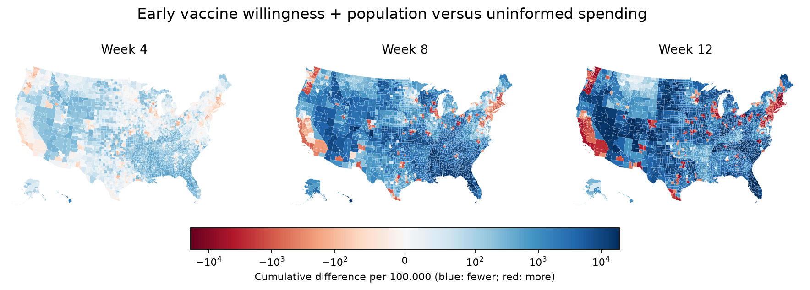

# U.S. weekly allocation: short results report

**Preliminary finding:** On the U.S. county network, July masking plus population cut modeled infections by **6.64%** versus the optimized uninformed plan. It cut infections by **1.60%** versus a population-only predictor, about **1.49 million** in this simulation. Masking by itself was slightly worse than the uninformed plan. The strongest tested proxy was earlier CTIS vaccine willingness plus population: **7.82%** fewer modeled infections versus uninformed and **2.85%** fewer versus population only (about **2.65 million**).

| Policy | Modeled new infections | Fewer than uninformed |
|---|---:|---:|
| No intervention | 299.53M | — |
| Optimized, no county behavioral data | 98.05M | — |
| Population-only predictor | 93.03M | 5.12% |
| July masking plus population | 91.54M | 6.64% |
| February CTIS vaccine willingness plus population | 90.38M | 7.82% |
| July masking alone | 98.53M | −0.50% |
| Surrogate oracle (sees the later county scores) | 71.80M | 26.77% |

The masking predictor recovered **24.79%** of the gap between uninformed allocation and the surrogate oracle. The experiment uses 3,142 actual Census county populations and twelve observed GeoDS mobility networks, with synthetic epidemic initialization and identical weekly budgets. The target is the county percentile of [HHS May–June 2021 vaccine non-hesitancy](https://aspe.hhs.gov/reports/vaccine-hesitancy-covid-19-state-county-local-estimates). Inputs include [NYT/Dynata July 2020 mask use](https://github.com/nytimes/covid-19-data/tree/master/mask-use); learned scores are predicted out of fold with five groups of states. The model uses the proposal's exponential effect on transmission and optimizes a weekly schedule. The 2020 mobility network supplies geography for this scenario; the exercise does not replay historical case counts or estimate a causal response to intervention spending.





## What held up

- **Behavior signal versus population.** Early willingness plus population recovered **29.22%** of the surrogate oracle gap. Adding both October CTIS masking and July masking to that model produced 90.82M infections (7.37% fewer versus uninformed), so the extra inputs did not help allocation. Adding only October CTIS masking to the July masking and population model produced 90.89M (7.30% fewer).

- **Perfect-information check.** In 16 separate synthetic scenarios with independent 0–100% county responsiveness, perfect information cut modeled infections by **17.57%** versus the frozen uninformed policy (paired-world bootstrap interval **16.93–18.14%**). Mean totals were 299.53M without intervention, 188.34M uninformed and 155.25M with perfect information. These independent worlds are distinct from the survey-surrogate geography above. Applying the survey plans to those unrelated maps did not improve allocation.
- **Raw-score sensitivity.** On the original HHS fraction scale, the uninformed plan already reduced infections by 98.57% versus no intervention at this dose. Masking plus population reduced the remaining infections by **2.82%** (about **121,000**), and the surrogate oracle by **5.50%**. This changes both the mean and spread of responsiveness, so it is a scale sensitivity check rather than an isolated test of variance.
- **Spread and coverage.** NYT masking covered all counties and had a county standard deviation of **11.13 percentage points**. February CTIS willingness had a spread of **8.46 points** in 475 counties (74.4% of the population). In the 462 counties shared by all indicators, willingness had the largest spread (8.38 points versus 6.94 for NYT masking), but similar rank correlation with the later HHS target (0.66 versus 0.67). Wider variation is useful only when it tracks the response we need to predict. Rank stretching of the learned scores worsened outcomes versus the uninformed plan in the three calibration follow-ups.

The observed proxy results concern one nationwide target map. The interval from the synthetic benchmark does not quantify uncertainty in these proxy effects. A useful next test is to validate against measured changes after a specific outreach intervention.

## Reproduction

Prepare the geographic inputs using the repository's [U.S. data instructions](../../README.md#us-data-and-reproduction). The frozen comparator is created by the static then weekly development runs below. Reproduce the 16 pure-information maps in four batches and aggregate them before testing proxies.

```bash
ROOT=outputs/us_perfect_information
STATIC=$ROOT/recipient_0.36_0.8_0.15_1010000_stratified
WEEKLY=${STATIC}_weekly
python -m epidemic.us_perfect_information --mechanism recipient --dose .8 --prior-scheme stratified --iterations 80
python -m epidemic.us_perfect_information --mechanism recipient --dose .8 --prior-scheme stratified --iterations 80 --schedule weekly --warmstart-from "$STATIC"
for seed in 1011000 1011004 1011008 1011012; do
  python -m epidemic.us_perfect_information --mechanism recipient --dose .8 --prior-scheme stratified --iterations 80 --schedule weekly --phase confirmation --worlds 4 --seed-start "$seed" --prior-from "$WEEKLY"
done
python -m epidemic.us_perfect_confirmation
python -m epidemic.us_weekly_proxy
python -m epidemic.us_perfect_stress
# Optional CTIS follow-ups, with the inputs described below:
python -m epidemic.us_weekly_proxy_followup
python -m epidemic.us_weekly_proxy_followup --acceptance data/raw/vaccine_experiment/acceptance_2021-02.csv
python -m epidemic.us_weekly_proxy_variation
python -m epidemic.us_weekly_proxy_figures
```

The CTIS follow-ups use the October 2020 descriptive county aggregates of `smoothed_wwearing_mask` (at least seven observed days) and the February 2021 `smoothed_waccept_covid_vaccine` daily export. See [Delphi signal definitions](https://cmu-delphi.github.io/delphi-epidata/api/covidcast-signals/fb-survey.html) and the defaults in `us_weekly_proxy_followup.py`. Full result tables are in this folder.
